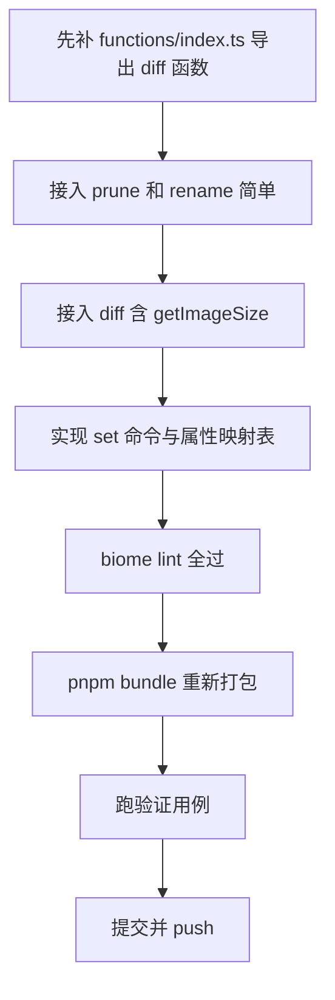

# CLI 命令扩展执行方案（prune / rename / diff / set）

> 目标：在 `packages/cli/src/cli.ts` 接入 4 个新命令，并重新 esbuild bundle 到 `fairygui-tools.mjs`。
> 本文为详细执行方案，**暂不执行，待确认**。
> 接入方式参照已完成的 `validate` 命令（import + HELP + switch + cmdXxx）。

## 一、总览

| 命令 | 用途 | 底层能力 | 是否写回工程 | 难度 |
|------|------|----------|--------------|------|
| prune | 裁剪未引用资源/空组件 | `prune()` Transform | 是 | 低 |
| rename | 重命名资源并更新引用 | `rename()` Transform | 是 | 低 |
| diff | 两个工程的 XML/图片差异 | `diffXmlProjects()` / `diffImageProjects()` | 否（只读） | 中 |
| set | 修改组件节点属性 | core 的 setXxx API + `authoring.ts` | 是 | 高 |

前 3 个是 functions 包现成函数，接入简单（和 validate 同模式）。`set` 是新封装，需设计属性映射表，是本方案重点。

## 二、共同基础：写回工程机制

prune / rename / set 三个命令都需要**改完写回 .fairy 工程**。现有 cli 的 inspect（只读）、publish（写二进制不写工程）、restore（写新工程目录）都没用到"原地写回"。本次引入 `NodeIO.writeProject`。

`NodeIO` 已从 `PlatformIO` 继承 `writeProject(doc, projectPath)`（`platform-io.ts:24`），内部用 `ProjectWriter` 写回 package.xml + 组件 XML。用法：

```ts
const io = new NodeIO();
const doc = await io.readProject(fairyPath);
// ... 改 doc ...
await io.writeProject(doc, fairyPath);  // 原地写回
```

注意：`writeProject` 写回的是 `.fairy` 工程目录（package.xml + assets/<包>/组件.xml），不是二进制。set/prune/rename 改的都是工程 XML，写回后可用 FairyGUI 编辑器打开。

## 三、命令一：prune（裁剪）

### 3.1 用法

```bash
ofgui prune <project-dir> [--empty-components] [--keep-unused]
```

### 3.2 参数

| 参数 | 说明 |
|------|------|
| `<project-dir>` | 工程目录或 .fairy 文件 |
| `--empty-components` | 同时删除无子对象的空组件（默认不删） |
| `--keep-unused` | 不删未引用资源（默认会删） |

### 3.3 实现骨架

```ts
async function cmdPrune(args: string[]): Promise<void> {
  const { values, positionals } = parseArgs({
    args,
    options: {
      'empty-components': { type: 'boolean' },
      'keep-unused': { type: 'boolean' },
    },
    allowPositionals: true,
  });
  if (positionals.length === 0) {
    console.error('Usage: ofgui prune <project-dir> [--empty-components] [--keep-unused]');
    process.exit(1);
  }
  const fairyPath = await resolveFairyPath(positionals[0]);
  const io = new NodeIO();
  const doc = await io.readProject(fairyPath);
  await doc.transform(prune({
    emptyComponents: values['empty-components'] ?? false,
    unusedResources: !(values['keep-unused'] ?? false),
  }));
  await io.writeProject(doc, fairyPath);
  console.log(`prune: done, written back to ${fairyPath}`);
}
```

### 3.4 改动点

- `cli.ts` import 加 `prune`
- HELP 加 prune 命令行 + Prune options 段
- switch 加 `case 'prune'`
- 新增 `cmdPrune` 函数

## 四、命令二：rename（重命名资源）

### 4.1 用法

```bash
ofgui rename <project-dir> <package> <resource> <newName> [--no-update-refs]
```

### 4.2 参数

| 参数 | 说明 |
|------|------|
| `<project-dir>` | 工程目录或 .fairy 文件 |
| `<package>` | 包名 |
| `<resource>` | 资源原名 |
| `<newName>` | 新名称 |
| `--no-update-refs` | 不更新引用该资源的 ui:// 链接（默认会更新） |

### 4.3 实现骨架

```ts
async function cmdRename(args: string[]): Promise<void> {
  const { values, positionals } = parseArgs({
    args,
    options: { 'no-update-refs': { type: 'boolean' } },
    allowPositionals: true,
  });
  if (positionals.length < 4) {
    console.error('Usage: ofgui rename <project-dir> <package> <resource> <newName> [--no-update-refs]');
    process.exit(1);
  }
  const [proj, pkg, res, newName] = positionals;
  const fairyPath = await resolveFairyPath(proj);
  const io = new NodeIO();
  const doc = await io.readProject(fairyPath);
  await doc.transform(rename({
    packageName: pkg, resourceName: res, newName,
    updateReferences: !(values['no-update-refs'] ?? false),
  }));
  await io.writeProject(doc, fairyPath);
  console.log(`rename: ${pkg}/${res} -> ${newName}, written back to ${fairyPath}`);
}
```

### 4.4 改动点

- `cli.ts` import 加 `rename`（和 `type RenameOptions` 可选）
- HELP 加 rename 命令行 + Rename options 段
- switch 加 `case 'rename'`
- 新增 `cmdRename` 函数

## 五、命令三：diff（工程差异对比）

### 5.1 用法

```bash
ofgui diff <source-dir> <restored-dir> [--images] [--json]
```

对比两个 FairyGUI 工程（通常是原工程 vs restore 还原的工程）的 XML 结构差异，可选对比图片尺寸差异。

### 5.2 参数

| 参数 | 说明 |
|------|------|
| `<source-dir>` | 源工程目录（含 assets/<包>/） |
| `<restored-dir>` | 还原工程目录 |
| `--images` | 同时对比图片尺寸（默认只对比 XML） |
| `--json` | 输出机器可读 JSON（默认人读文本） |

### 5.3 底层接口

- `diffXmlProjects(sourceDir, restoredDir): Promise<DiffReport>`（`roundtrip-diff.ts:452`）
- `diffImageProjects(sourceDir, restoredDir, getImageSize): Promise<ImageDiffReport>`（`roundtrip-diff.ts:625`），第三参数需一个图片尺寸读取器

DiffReport 结构（已确认）：
```ts
interface DiffReport {
  summary: { totalFiles; matchingFiles; diffFiles; missingFiles };
  diffs: DiffEntry[];  // { package, component, path, expected, actual, type }
  missingInRestored: string[];
  extraInRestored: string[];
}
```

### 5.4 getImageSize 实现（不依赖 sharp）

`--images` 模式需要读图片尺寸。为保证单文件 bundle 可用（不依赖 sharp），在 cli 里自实现一个 PNG/JPEG 头尺寸读取器（参考 `project-reader.ts:43-90` 的 `readPngSize`/`readJpegSize`，约 40 行）：

```ts
async function getImageSize(filePath: string): Promise<{ width: number; height: number } | null> {
  const buf = await fs.readFile(filePath);
  const data = new Uint8Array(buf.buffer, buf.byteOffset, buf.byteLength);
  // PNG: 校验签名 + 读 IHDR 的 width/height (offset 16/20, uint32)
  // JPEG: 扫描 SOF 段读 width/height
  ...
}
```

这样 diff --images 不需要 sharp，纯单文件可用。

### 5.5 实现骨架

```ts
async function cmdDiff(args: string[]): Promise<void> {
  const { values, positionals } = parseArgs({
    args,
    options: { images: { type: 'boolean' }, json: { type: 'boolean' } },
    allowPositionals: true,
  });
  if (positionals.length < 2) {
    console.error('Usage: ofgui diff <source-dir> <restored-dir> [--images] [--json]');
    process.exit(1);
  }
  const [sourceDir, restoredDir] = positionals.map(p => path.resolve(p));
  const xmlReport = await diffXmlProjects(sourceDir, restoredDir);
  if (values.json) {
    console.log(JSON.stringify(xmlReport, null, 2));
  } else {
    printDiffReport(xmlReport);
  }
  if (values.images) {
    const imgReport = await diffImageProjects(sourceDir, restoredDir, getImageSize);
    if (values.json) console.log(JSON.stringify(imgReport, null, 2));
    else printImageDiffReport(imgReport);
  }
  if (!xmlReport.summary.diffFiles && xmlReport.missingInRestored.length === 0) {
    // 无差异可视为成功
  } else {
    process.exit(1);  // 有差异退出码 1，便于脚本检测
  }
}
```

### 5.6 改动点

- `cli.ts` import 加 `diffXmlProjects, diffImageProjects`（从 functions；需确认 functions/index.ts 是否导出，若未导出需补导出）
- HELP 加 diff 命令行 + Diff options 段
- switch 加 `case 'diff'`
- 新增 `cmdDiff` + `getImageSize`（PNG/JPEG 头读取）+ `printDiffReport` + `printImageDiffReport`

> 注：`diffXmlProjects` / `diffImageProjects` 当前未在 `functions/src/index.ts` 导出，需先在 index.ts 补 `export { diffXmlProjects, diffImageProjects, type DiffReport, type DiffEntry } from './roundtrip-diff.js';`

## 六、命令四：set（修改组件节点属性）—— 重点

### 6.1 用法

```bash
ofgui set <project-dir> <package>/<component> <key=value>...
```

key 不带前缀 → 设置组件根属性；key 带 `childName.` 前缀 → 设置指定 child 属性。

### 6.2 示例

```bash
# 设置组件根尺寸
ofgui set ./UI Basics/Main width=800 height=600

# 设置某 child 的文本和位置
ofgui set ./UI Basics/Button n0.text=确认 n0.x=100 n0.y=50

# 设置 button 标题和图标
ofgui set ./UI Basics/Button title=开始 icon=ui://rbw1tv9tabcd1234

# 设置可见性
ofgui set ./UI Basics/Panel n0.visible=false n0.alpha=0.5
```

### 6.3 定位逻辑

- 包定位：`root.listPackages().find(p => p.getName() === pkg)`
- 组件定位：`pkg.listComponents().find(c => c.getName() === component)`
- child 定位：`component.listChildren().find(ch => ch.getName() === childName || ch.getId() === childName)`
- 组件根本身：当 key 无前缀时，目标就是 component（GComponent）

### 6.4 属性映射表（核心设计）

用一张数据表定义 `key → { setter, parser }`，便于扩展。第一版支持如下属性：

**通用属性（所有 child 类型，IGObject）**

| key | 值类型 | 调用 | 示例 |
|-----|--------|------|------|
| x | number | setX | x=100 |
| y | number | setY | y=50 |
| xy | "x,y" | setXY | xy=100,50 |
| width | number | setWidth | width=200 |
| height | number | setHeight | height=80 |
| size | "w,h" | setSize | size=200,80 |
| visible | bool | setVisible | visible=false |
| alpha | number | setAlpha | alpha=0.5 |
| rotation | number | setRotation | rotation=45 |
| scale | "sx,sy" | setScale | scale=1.5,1.5 |
| pivot | "px,py" | setPivot | pivot=0.5,0.5 |
| grayed | bool | setGrayed | grayed=true |
| touchable | bool | setTouchable | touchable=false |
| group | string | setGroup | group=g1 |
| src | string | setSrc | src=ui://xxxxxxxx... |

**GButton 特有**

| key | 值类型 | 调用 |
|-----|--------|------|
| title | string | setTitle |
| icon | string | setIcon |
| selectedTitle | string | setSelectedTitle |
| selectedIcon | string | setSelectedIcon |
| titleColor | string | setTitleColor |
| titleFontSize | number | setTitleFontSize |
| sound | string | setSound |
| mode | number | setMode |

**GLabel 特有**：title / icon / titleColor / titleFontSize / sound（同 Button 对应项）

**GTextField / GTextInput / GRichTextField 特有**

| key | 值类型 | 调用 |
|-----|--------|------|
| text | string | setText |
| font | string | setFont |
| fontSize | number | setFontSize |
| color | string | setColor |
| bold | bool | setBold |
| italic | bool | setItalic |

**GGraph 特有**

| key | 值类型 | 调用 |
|-----|--------|------|
| lineColor | string | setLineColor |
| fillColor | string | setFillColor |
| lineSize | number | setLineSize |

> 第一版覆盖通用 + Button + Label + TextField + Graph 子集。其余类型（GLoader/GMovieClip/GList/GComboBox/GProgressBar/GSlider/Controller/Transition）的属性表后续按需扩展，只需往映射表加条目。

### 6.5 映射表数据结构

```ts
type ValueParser = (raw: string) => unknown;
interface PropertyBinding {
  key: string;
  appliesTo?: string[];  // 限定 child 类型，缺省=通用
  setter: (node: any, value: unknown) => void;
  parse: ValueParser;
}

const PROPERTY_BINDINGS: PropertyBinding[] = [
  { key: 'x', setter: (n, v) => n.setX(v as number), parse: Number },
  { key: 'y', setter: (n, v) => n.setY(v as number), parse: Number },
  { key: 'xy', setter: (n, v) => { const [a,b]=v as number[]; n.setXY(a,b); }, parse: parsePair },
  { key: 'width', setter: (n, v) => n.setWidth(v as number), parse: Number },
  // ...
  { key: 'title', appliesTo: ['GButton','GLabel'], setter: (n, v) => n.setTitle(v as string), parse: String },
  { key: 'text', appliesTo: ['GTextField','GTextInput','GRichTextField'], setter: (n, v) => n.setText(v as string), parse: String },
  // ...
];
```

helper：
- `parsePair(str)` → `str.split(',').map(Number)`
- `parseBool(str)` → `str==='true' || str==='1'`
- 值类型推断：key 在表里定义 parse，统一处理

### 6.6 实现骨架

```ts
async function cmdSet(args: string[]): Promise<void> {
  const { positionals } = parseArgs({ args, options: {}, allowPositionals: true });
  if (positionals.length < 3) {
    console.error('Usage: ofgui set <project-dir> <package>/<component> <key=value>...');
    process.exit(1);
  }
  const [proj, target, ...assignments] = positionals;
  const slashIdx = target.indexOf('/');
  if (slashIdx < 0) { console.error('target must be package/component'); process.exit(1); }
  const pkgName = target.slice(0, slashIdx);
  const compName = target.slice(slashIdx + 1);

  const fairyPath = await resolveFairyPath(proj);
  const io = new NodeIO();
  const doc = await io.readProject(fairyPath);
  const root = doc.getRoot();
  const pkg = root.listPackages().find(p => p.getName() === pkgName);
  if (!pkg) { console.error(`package "${pkgName}" not found`); process.exit(1); }
  const comp = pkg.listComponents().find(c => c.getName() === compName);
  if (!comp) { console.error(`component "${compName}" not found in ${pkgName}`); process.exit(1); }

  let changed = 0;
  for (const a of assignments) {
    const eq = a.indexOf('=');
    if (eq < 0) { console.warn(`skip invalid assignment: ${a}`); continue; }
    const key = a.slice(0, eq);
    const val = a.slice(eq + 1);
    const dot = key.indexOf('.');
    const childName = dot > 0 ? key.slice(0, dot) : null;
    const propKey = dot > 0 ? key.slice(dot + 1) : key;
    const node = childName
      ? comp.listChildren().find(ch => ch.getName() === childName || ch.getId() === childName)
      : comp;
    if (!node) { console.warn(`child "${childName}" not found, skip`); continue; }
    const binding = PROPERTY_BINDINGS.find(b => b.key === propKey && (!b.appliesTo || b.appliesTo.includes(node.constructor?.name)));
    if (!binding) { console.warn(`unsupported key "${propKey}", skip`); continue; }
    binding.setter(node, binding.parse(val));
    changed++;
  }

  await io.writeProject(doc, fairyPath);
  console.log(`set: applied ${changed} assignment(s), written back to ${fairyPath}`);
}
```

### 6.7 改动点

- `cli.ts` import 加 `NodeIO`（已有）+ 不需新 functions import（set 用 core API，已通过 `@openfairygui/core` 可得；GButton/GLabel 等类型已 bundle）
- HELP 加 set 命令行 + Set options 段
- switch 加 `case 'set'`
- 新增 `cmdSet` + `PROPERTY_BINDINGS` 表 + helper（parsePair/parseBool）
- 注意：child 类型判断用 `node.constructor?.name` 或 `propertyType` 字段（需确认 core 暴露方式）

## 七、改动文件清单

| 文件 | 改动 |
|------|------|
| `packages/cli/src/cli.ts` | import 4 组、HELP 4 段、switch 4 case、4 个 cmd 函数 + set 的映射表 + diff 的 getImageSize |
| `packages/functions/src/index.ts` | 补导出 `diffXmlProjects, diffImageProjects, type DiffReport, type DiffEntry`（当前未导出） |
| `fairygui-tools.mjs` | 重新 `pnpm bundle` |
| `package.json` | 无需改（bundle 脚本已存在） |

## 八、HELP 文本新增（示意）

```
Commands:
  ...（原有）
  prune <project-dir> [options]                   Prune unreferenced resources and empty components
  rename <project-dir> <pkg> <res> <newName> [options]  Rename a resource and update references
  diff <source-dir> <restored-dir> [options]      Diff two projects (XML and optional images)
  set <project-dir> <pkg>/<comp> <key=value>...   Set component or child properties

Prune options:
  --empty-components    Also remove components with no children
  --keep-unused         Do not remove unreferenced resources

Rename options:
  --no-update-refs      Do not update ui:// references to the renamed resource

Diff options:
  --images              Also compare image sizes
  --json                Output machine-readable JSON
```

## 九、验证用例

```bash
# 1. prune：裁剪后工程变小，未引用资源消失
node fairygui-tools.mjs prune ./UI --empty-components
node fairygui-tools.mjs inspect ./UI   # 对比裁剪前后计数

# 2. rename：重命名后引用同步更新
node fairygui-tools.mjs rename ./UI Basics Button PrimaryButton
node fairygui-tools.mjs validate ./UI  # 确认无断裂引用

# 3. diff：原工程 vs restore 还原工程
node fairygui-tools.mjs restore ./release --output ./restored
node fairygui-tools.mjs diff ./UI ./restored --images

# 4. set：改属性后写回，inspect/编辑器验证
node fairygui-tools.mjs set ./UI Basics/Button n0.text=确认 n0.x=100
node fairygui-tools.mjs inspect ./UI

# 5. lint + bundle 通过
npx biome lint packages/cli/src/cli.ts
pnpm bundle
node fairygui-tools.mjs --help   # 确认 4 个新命令都在
```

## 十、风险与注意事项

### 10.1 严重

| 编号 | 问题 | 应对 |
|------|------|------|
| S1 | **writeProject 原地覆盖工程** | prune/rename/set 会改原工程文件。建议先备份或加 `--dry-run` 预览（第一版可不做，但文档警告用户） |
| S2 | **set 属性映射不全** | 第一版只覆盖通用+Button+Label+TextField+Graph。其他类型属性会 skip 并 warn，不影响其他赋值 |
| S3 | **child 类型判断方式** | 需确认 core 节点如何暴露类型名（constructor.name 在 bundle 后可能被混淆；优先用 `propertyType` 字段，inspect 已用它判类型） |

### 10.2 中等

| 编号 | 问题 | 应对 |
|------|------|------|
| M1 | **diff 的 index.ts 导出** | roundtrip-diff 函数当前未在 functions/index.ts 导出，必须先补导出否则 bundle 报 unresolved |
| M2 | **set 的值类型解析** | 数字/布尔/数组对解析，错格式要 warn 跳过不崩 | 
| M3 | **diff --images 的 PNG/JPEG 头读取** | 自实现 ~40 行，参考 project-reader.ts:43-90；不依赖 sharp |
| M4 | **rename 的 child 引用更新范围** | rename 默认 updateReferences=true，会扫所有 displayList 的 src；大工程稍慢 |

### 10.3 轻微

| 编号 | 问题 | 应对 |
|------|------|------|
| L1 | **set 多赋值原子性** | 一个赋值失败不影响其他（逐个 try），最后统一写回 |
| L2 | **bundle 体积增长** | 加 4 命令 + roundtrip-diff（~700 行），预计 908KB → ~1MB |
| L3 | **diff 退出码** | 有差异退出 1，无差异 0，便于 CI 检测 |

## 十一、落地顺序



建议按此顺序，每步可独立验证：
1. **prune + rename**（最简单，同 validate 模式 + writeProject）
2. **diff**（需补 index.ts 导出 + getImageSize）
3. **set**（最复杂，属性映射表）
4. lint + bundle + 验证
5. 提交 push

## 十二、待确认事项

1. **set 第一版属性范围**：上表的通用+Button+Label+TextField+Graph 子集够吗？要加 GLoader/GList/Controller 吗？
2. **是否加 --dry-run**：prune/rename/set 是否需要 dry-run 预览不写回？（防误改原工程）
3. **set 的 child 定位**：按 name 还是 id 优先？（建议 name 优先，id 兜底）
4. **diff 退出码语义**：有差异=1 还是总是 0 只输出报告？
5. **set 能否改组件根本身属性**（组件根是 GComponent，有 sourceWidth/sourceHeight 等），第一版要不要支持组件根属性？

确认以上后即可按落地顺序执行。

---

## 引用说明

本文档基于以下源码分析整理：
- `packages/functions/src/prune.ts` — `prune()` Transform，PruneOptions
- `packages/functions/src/rename.ts` — `rename()` Transform，RenameOptions
- `packages/functions/src/roundtrip-diff.ts` — `diffXmlProjects()` / `diffImageProjects()`，DiffReport/DiffEntry 结构
- `packages/core/src/io/platform-io.ts` — `writeProject()` 写回工程（set/prune/rename 基础）
- `packages/core/src/io/node-io.ts` — NodeIO 继承 writeProject
- `packages/core/src/properties/g-button.ts` / `g-label.ts` / `g-graph.ts` / `g-text-field.ts` — setXxx API
- `packages/core/src/authoring.ts` — composeController/composeTransition/bindLookGear 创作 API（set 暂不直接用，备查）
- `packages/functions/src/index.ts` — 需补 diff 函数导出
- `packages/cli/src/cli.ts` — validate 接入模式参照
